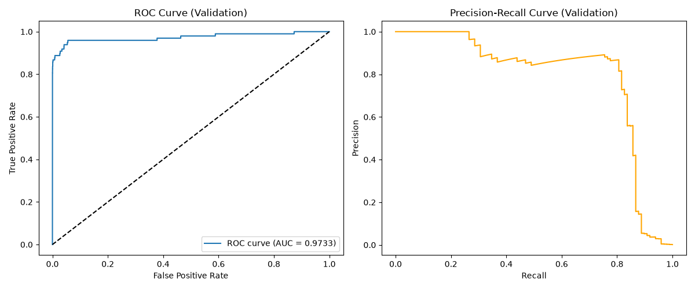

# Лабораторна робота №2: Поріг рішення під асиметричну ціну помилок

**Стек технологій:** Python 3.12, PyTorch, NumPy, pandas, scikit-learn, Matplotlib.

**Джерело даних:** [Credit Card Fraud Detection Dataset (Kaggle)](https://www.kaggle.com/datasets/mlg-ulb/creditcardfraud).

### Команди для відтворення запуску через uv:

Навчання моделі та аналіз з вихідного CSV-файлу:
```uv run python DeepL_Lab2.py --data creditcard.csv --out results```

Аналіз зі збережених прогнозів (без повторного навчання та без CSV):
```uv run python DeepL_Lab2.py --saved results```

### Поділ даних та стандартизація

Вихідний датасет містить 284 807 транзакцій, з яких лише 492 є шахрайськими. Для навчання моделі виділено 29 ознак: $V_1 \dots V_{28}$ та Amount. Ознаки Class та Time до входу моделі не включалися. Сире значення Amount збережено окремо для аналізу помилок.

### Стратифікований поділ (60 / 20 / 20)

Розподіл здійснено у два етапи за допомогою train_test_split з фіксованим зерном random_state = 0 та збереженням початкового порядку рядків CSV:

Відокремлено навчальну вибірку Train (60%) та відкладені індекси **(40%)** із параметром stratify=y.
    
 Відкладені індекси поділено навпіл з параметром `stratify=y`. отримано Validation (20%) та Test (20%).
#### Таблиця статистики поділу вибірок:

|**Вибірка**|**Загальна кількість об'єктів (N)**|**Кількість шахрайств (Class=1)**|**Частка шахрайств (%)**|
|---|---|---|---|
|**Train**|170 884|295|0.1726%|
|**Validation**|56 961|98|0.1720%|
|**Test**|56 962|99|0.1738%|

### Чому статистики стандартизації обчислюються лише на Train?

Стандартизація ознак здійснюється за допомогою `StandardScaler` за формулою:

$$z = \frac{x - \mu}{\sigma}$$

Де $\mu$ — середнє значення ознаки, а $\sigma$ — її стандартне відхилення.

Статистики $\mu$ та $\sigma$ повинні обчислюватися лише на навчальній вибірці за допомогою методу .fit(). До валідаційної та тестової вибірок застосовується лише метод .transform() з використанням вже порахованих статистик з навчальної вибірки.

Якщо обчислити $\mu$ та $\sigma$ на всьому наборі даних, виникне витік даних (data leakage) і модель дізнається про розподіл і масштаб даних з майбутніх валідаційних та тестових вибірок ще до початку навчання. Це призводить до погіршення якості роботи моделі з реальними новими даними.

### Формули метрик та асиметричної вартості помилок

Функція вартості помилок:
$$C(t) = 10 \cdot FN(t) + FP(t)$$
де $FN(t)$ це пропущене шахрайство (дорога помилка, штраф = 10), а $FP(t)$ це хибна тривога (блокування чесної транзакції, штраф = 1).

Точність (Precision):
$$\text{Precision} = \frac{TP}{TP + FP}$$
Повнота (Recall):
$$\text{Recall} = \frac{TP}{TP + FN}$$

Якщо знаменник у формулах $TP + FP = 0$ або $TP + FN = 0$, відповідна метрика математично не визначена через операцію ділення на нуль.

При $TP + FP = 0$ поріг $t$ встановлено настільки високим, що модель не спрогнозувала жодного позитивного класу ($TP=0, FP=0$). Модель не зробила жодного ствердного прогнозу, тому оцінити точність позитивних передбачень неможливо.

При $TP + FN = 0$ у вибірці взагалі відсутні позитивні приклади, тобто сума фактичних позитивних міток дорівнює нулю.
Вибір порога та перевірка алгоритму (Unit-тести)

### Результати та порівняння правил на Validation

ROC-AUC на Validation: 0.9733

Оптимальний поріг ($t^*$): 0.031194

Графіки побудовані та збережені у `results/curves.png`



#### Підсумкова таблиця порівняння правил рішення (Validation):

|**Правило на validation**|**Поріг**|**TP**|**FP**|**FN**|**TN**|**Вартість C**|
|---|---|---|---|---|---|---|
|**Стандартний поріг**|$0.5$|71|9|27|56 854|**279**|
|**Мінімум вартості**|$t^* \approx 0.031194$|82|34|16|56 829|**194**|
|**Усі негативні**|$+\infty$|0|0|98|56 863|**980**|

> Повна CSV-таблиця всіх кандидатів збережена за шляхом `results/validation_candidates.csv`.

Чому висока ROC-AUC не гарантує малої вартості помилок чи високої точності (Precision)?

ROC-AUC оцінює співвідношення $TPR = \frac{TP}{TP + FN}$ та $FPR = \frac{FP}{FP + TN}$ при всіх можливих порогах. В умовах екстремального дисбалансу класів, знаменник $FPR$ є величезним. Навіть при сотнях хибних тривог ($FP$) значення $FPR$ залишається близьким до нуля, що забезпечує високий показник ROC-AUC (понад 0.97). Однак Precision $=\frac{TP}{TP + FP}$ при цьому може бути низьким, а вартість високою через великий штраф за пропущені шахрайства.
### Результати незалежної перевірки на малих наборах (Unit-тести)

Для підтвердження коректності швидкого алгоритму проведено порівняння з повільним прямим перебором для кожного кандидата на трьох контрольних наборах:

| **Набір** | Оцінки s                         | Мітки y                   | Перевіряємий сценарій                     | Результат перевірки        |
| --------- | -------------------------------- | ------------------------- | ----------------------------------------- | -------------------------- |
| **A**     | `[0.9, 0.7, 0.7, 0.4, 0.2, 0.1]` | `[0, 1, 0, 1, 0, 0]`      | Коректне групування рівних оцінок ($0.7$) | ПРОЙДЕНО ($t^* = 0.4$)     |
| **B**     | `[0.9, 0.6, 0.3]`                | `[0, 0, 0]`               | Роботу за відсутності позитивних міток    | ПРОЙДЕНО ($t^* = +\infty$) |
| **C**     | `[0.8, 0.5 (11 разів), 0.2]`     | `[1, 1, 0 (10 разів), 0]` | Вибір найбільшого порога при нічиї за $C$ | ПРОЙДЕНО ($t^* = 0.8$)     |

### Результати незалежної перевірки на малих наборах (Unit-тести)

Для підтвердження коректності алгоритму $O(n \log n)$ проведено порівняння з повільним прямим перебором $O(n^2)$ на трьох контрольних наборах даних.

#### Набір A (Рівні оцінки)
Оцінки s: [0.9, 0.7, 0.7, 0.4, 0.2, 0.1]
Мітки y: [0, 1, 0, 1, 0, 0]
Сценарій: Перевіряє коректність обробки ситуацій, коли декілька об'єктів мають однакові оцінки ($0.7$), але належать до різних класів. Такі об'єкти повинні групуватися й отримувати однаковий прогноз.

| Поріг $t$ | TP  | FP  | FN  | TN  | Вартість $C$ |
| :-------: | :-: | :-: | :-: | :-: | :----------: |
| $+\infty$ |  0  |  0  |  2  |  4  |      20      |
|    0.9    |  0  |  1  |  2  |  3  |      21      |
|    0.7    |  1  |  2  |  1  |  2  |      12      |
|    0.4    |  2  |  2  |  0  |  2  |      2       |
|    0.2    |  2  |  3  |  0  |  1  |      3       |
|    0.1    |  2  |  4  |  0  |  0  |      4       |

Обраний поріг $t^* = 0.4$. Результати обох алгоритмів повністю збігаються.

---

#### Набір B (Відсутність позитивних міток)

Оцінки s: [0.9, 0.6, 0.3]
Мітки y: [0, 0, 0]
Сценарій: Перевіряє граничний випадок без позитивних міток класу ($y=0$) та демонструє необхідність додавання кандидата $+\infty$.

| Поріг $t$ | TP | FP | FN | TN | Вартість $C$ |
| :---: | :---: | :---: | :---: | :---: | :---: |
| **$+\infty$** | **0** | **0** | **0** | **3** | **0** |
| 0.9 | 0 | 1 | 0 | 2 | 1 |
| 0.6 | 0 | 2 | 0 | 1 | 2 |
| 0.3 | 0 | 3 | 0 | 0 | 3 |

Обраний поріг $t^* = +\infty$. Результати обох алгоритмів повністю збігаються.

---

#### Набір C (Нічия за вартістю)

Оцінки s: [0.8, 0.5 (×11), 0.2]
Мітки y: [1, 1, 0 (×10), 0]
Сценарій: Перевіряє правило розв'язання нічиєї. При однаковій мінімальній вартості ($C=10$) алгоритм повинен обрати найбільший поріг ($0.8$ замість $0.5$), щоб мінімізувати хибні блокування.

| Поріг $t$ | TP  | FP  | FN  | TN  | Вартість $C$ |
| :-------: | :-: | :-: | :-: | :-: | :----------: |
| $+\infty$ |  0  |  0  |  2  | 11  |      20      |
|    0.8    |  1  |  0  |  1  | 11  |      10      |
|    0.5    |  2  | 10  |  0  |  1  |      10      |
|    0.2    |  2  | 11  |  0  |  0  |      11      |
Обраний поріг $t^* = 0.8$. Результати обох алгоритмів повністю збігаються.

## Тестова оцінка та аналіз помилок

Знайдений на валідації поріг $t^* = 0.031194$ зафіксовано та застосовано до тестової вибірки без будь-якої зміни моделі чи налаштувань.

### Підсумкові результати на Test:

- Матриця плутанини: TP = 80, FP = 43, FN = 19, TN = 56,820
- Загальна вартість помилок $C(t^*)$: 233
- Precision: 0.6504
- Recall: 0.8081

### Аналіз перших 5 помилок FP та перших 5 помилок FN

Нижче наведено перші 5 FP та перші 5 FN за номером рядка з початкового CSV-файлу:

| Рядок CSV  | Тип помилки | Мітка y | Оцінка $s_i$​ | Відстань $∥s_i​−t∗∥$ | Amount |
| ---------- | ----------- | ------- | ------------- | -------------------- | ------ |
| **13405**  | FP          | 0       | 0.932032      | 0.900838             | 89.99  |
| **34071**  | FP          | 0       | 0.033022      | 0.001828             | 1.00   |
| **107617** | FP          | 0       | 0.037130      | 0.005936             | 122.00 |
| **43432**  | FP          | 0       | 0.486640      | 0.455447             | 89.99  |
| **149865** | FP          | 0       | 0.783286      | 0.752092             | 1.00   |
| **93486**  | FN          | 1       | 0.018352      | 0.012842             | 0.00   |
| **142557** | FN          | 1       | 0.001567      | 0.029627             | 354.33 |
| **151103** | FN          | 1       | 0.001189      | 0.030005             | 33.76  |
| **112840** | FN          | 1       | 0.002076      | 0.029118             | 45.03  |
| **254344** | FN          | 1       | 0.002308      | 0.028886             | 187.11 |

#### Порівняння Amount та відстаней від порога

Більшість помилок FN мають оцінки, максимально близькі до нуля ($s_i < 0.003$), і знаходяться на значній відстані від порога $t^*$. Це свідчить про те, що модель була хибно впевнена у їхній легітимності. При цьому значення Amount для FN коливаються від 0.00 до 354.33, тобто сума транзакції прямо не корелює з помилкою.

Помилки FP поділяються на прикордонні ($s_i \approx 0.033$, дуже близько до $t^*$) та аномальні ($s_i > 0.78$), які модель помилково вважала шахрайськими з високою впевненістю.

#### Чи можна за 10 прикладами судити про причини помилок моделі?

Ні. 10 прикладів є статистично замалою вибіркою, щоб робити узагальнені висновки про системні вади моделі. Вони лише демонструють окремі випадки промахів та їхні характеристики.

#### Що змінив вибір порога в роботі незмінної моделі?
 
Зниження порога з $0.5$ до $t^* \approx 0.0312$ дозволило адаптувати модель під асиметричні штрафи, зробивши її значно чутливішою до рідкісного класу шахрайств.

#### Якою була ціна цього рішення в термінах FP і FN?

Ціною суттєвого зменшення $FN$ (на validation з 27 до 16) стало зростання $FP$ (з 9 до 34). Оскільки пропуск шахрайства коштує вдесятеро дорожче за хибну тривогу, таке рішення знизило сумарні збитки $C$ з 279 до 194 (на 30.5%).

#### Чому результат на Validation не гарантує такого самого виграшу на Test?

Поріг $t^*$ оптимізувався безпосередньо під конкретну валідаційну вибірку. Оскільки тестова вибірка є незалежною і має власні випадкові коливання розподілу даних, вартість на тесті ($C = 233$) дещо відрізняється від валідаційної ($C = 194$), хоча й залишається значно вигіднішою за стандартний поріг $0.5$.

#### Використання штучного інтелекту 
Під час виконання лабораторної роботи використовувався Gemini Flash 3.6 для допомоги розробки коду та написання звіту.
