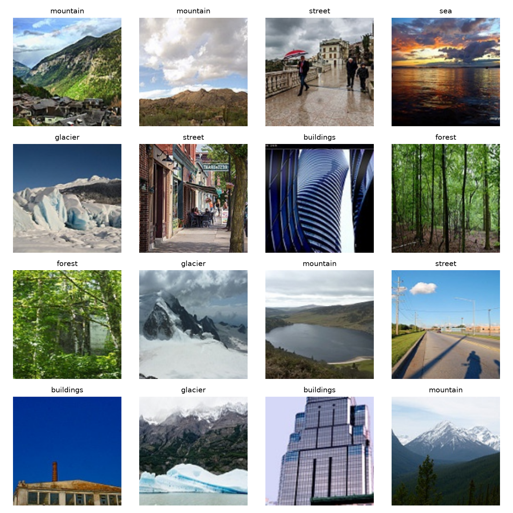
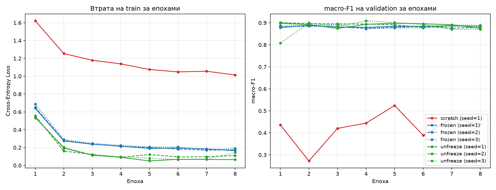
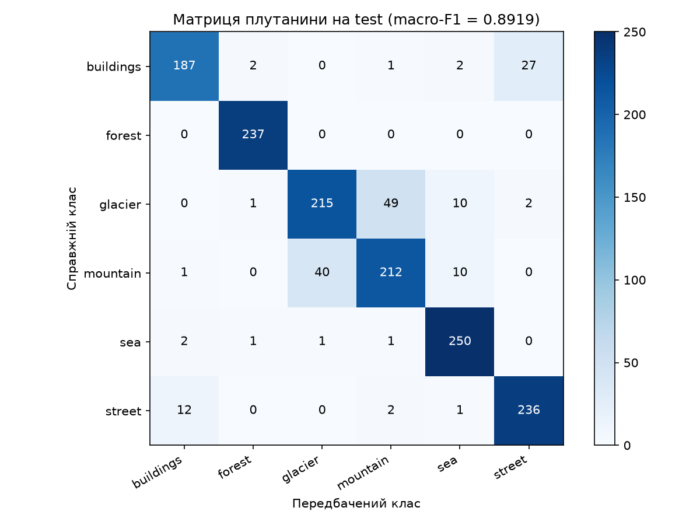
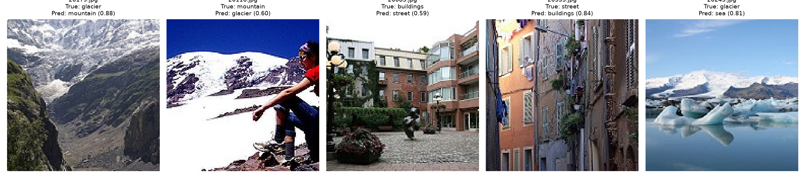

# Лабораторна робота №3. Обчислювальний експеримент і трансферне навчання

## Відтворюваність та команди запуску

Стек технологій: **Python 3.12**, **PyTorch**, **torchvision**, **NumPy**, **scikit-learn**, **Matplotlib**, **Pillow**

**Джерело даних:** [Intel Image Classification](https://www.kaggle.com/datasets/puneet6060/intel-image-classification).

Навчання і тестове оцінювання - CPU, AMD Ryzen 7 6800HS

Перевірки протоколу, навчання 7 запусків та вибір моделі за `validation` (вибірка `test` не використовується): 

```
uv run lab3-train --data-dir Lab3
```
 
 **Валідація хешів `split.csv`, розклад ефектів та одноразова оцінка на `test` на CPU**:

```
uv run lab3-analyze --data-dir Lab3
```

У результаті виконання обох команд у директорії лабораторної роботи формуються:

* `split.csv` — фіксований детермінований поділ файлів між `train`, `validation` і `test`;
* `runs/` — 7 підкаталогів із журналами навчання (`run.json`) та валідаційними логітами (`val_logits.npy`);
* `lab3_model.pt` — ваги та метадані фінальної вибраної моделі (`frozen`, `seed=3`);
* `figures/train_batch_preview.png` — візуалізація перших 16 зображень навчального батча після перетворень;
* `figures/training_curves.png` — криві `train loss` і `validation macro-F1` для всіх 7 запусків;
* `figures/confusion_matrix.png` — матриця плутанини ($6 \times 6$) на тестовій вибірці;
* `figures/top5_errors.png` — візуалізація п'яти характерних помилок на `test`.

Сам набір даних *Intel Image Classification* (`seg_train/`, `seg_test/`) до репозиторію не додається. Розподіл даних і контрольні перевірки повністю відтворюються зафіксованими `seed`, тоді як точні числові значення `macro-F1` під час повторного навчання на іншій машині можуть незначно відрізнятися залежно від апаратного середовища та версій бібліотек.

## Використані формули та метрики

У процесі виконання експериментів та аналізу результатів застосовувалися такі математичні вирази:

1. **Теоретична початкова втрата перехресної ентропії** (для $K = 6$ рівноймовірних класів до початку навчання):
   $$L_0 = \ln K = \ln 6 \approx 1.7918$$

2. **Оновлення ковзних статистик у шарах `BatchNorm2d`** (під час прямого проходу в режимі `train()`, де $m = 0.1$ — коефіцієнт імпульсу):
   $$\hat{x}_{\text{new}} = (1 - m)\hat{x}_{\text{old}} + m x_{\text{batch}}$$

3. **Середня `macro-F1` та розмах для режиму $r \in \{\text{frozen}, \text{unfreeze}\}$** за трьома запусками ($s \in \{1, 2, 3\}$):
   $$\overline{F}_r = \frac{1}{3} \sum_{s=1}^{3} F_{r,s}, \quad R_r = \max_{s} F_{r,s} - \min_{s} F_{r,s}$$

4. **Консервативний поріг міжзапускового шуму $R$**:
   $$R = \max(R_{\text{frozen}}, R_{\text{unfreeze}})$$

5. **Розклад ефектів трансферного навчання** (ефект попередньо навчених ознак $\Delta_{\text{pre}}$ та ефект розморожування $\Delta_{\text{unf}}$):
   $$\Delta_{\text{pre}} = \overline{F}_{\text{frozen}} - F_{\text{scratch},1}$$
   $$\Delta_{\text{unf}} = \overline{F}_{\text{unfreeze}} - \overline{F}_{\text{frozen}}$$
   $$\Delta_{\text{total}} = \Delta_{\text{pre}} + \Delta_{\text{unf}} = \overline{F}_{\text{unfreeze}} - F_{\text{scratch},1}$$

6. **Стандартна похибка частки правильних відповідей (`test accuracy`)** на вибірці обсягом $n = 1502$:
   $$SE = \sqrt{\frac{p(1 - p)}{n}}$$
## 1. Перевірки до навчання

### 1.1. Контроль поділу вибірки (`split.csv`)

Поділ сформовано детерміновано за допомогою `np.random.default_rng(0)` окремо для `train` (з теки `seg_train`) та для `validation`/`test` (з теки `seg_test`) у фіксованому порядку класів (`buildings`, `forest`, `glacier`, `mountain`, `sea`, `street`). Усі 18 клітинок повністю збігаються з контрольною таблицею; перевірено, що жоден файл не входить одночасно у дві частини.

|**Клас**|**train**|**validation**|**test**|
|---|---|---|---|
|**buildings**|200 / 1 996 761|218 / 4 837 323|219 / 4 837 559|
|**forest**|200 / 2 032 625|237 / 5 276 962|237 / 5 291 326|
|**glacier**|200 / 2 183 923|276 / 6 135 652|277 / 6 157 250|
|**mountain**|200 / 1 950 345|262 / 5 789 535|263 / 5 849 765|
|**sea**|200 / 1 987 613|255 / 5 655 068|255 / 5 668 011|
|**street**|200 / 1 841 817|250 / 5 541 845|251 / 5 547 533|
|**Разом**|**1200 / 11 993 084**|**1498 / 33 236 385**|**1502 / 33 351 444**|

### 1.2. Візуалізація пакета після перетворень

Нижче наведено перші 16 зображень одного навчального пакета ($160 \times 160$) після застосування аугментацій (`RandomResizedCrop`, `RandomHorizontalFlip`) та зворотного перетворення нормування ImageNet для візуальної перевірки коректності міток і перетворень:



### 1.3. Початкова втрата $L_0$ до навчання (`seed=1`)

**Теоретичне очікування:** для 6 класів за рівномірного прогнозування втрата становить $\ln 6 \approx 1.7918$.

**`scratch` (`seed=1`):** $L_0 = 1.8666$ (різниця $+0.0749$).
**`frozen` (`seed=1`):** $L_0 = 2.0837$ (різниця $+0.2919$).

**Пояснення відхилення:** невелике відхилення від $\ln 6$ зумовлене скінченним розміром одного батча ($32$ зображення), випадковим нерівномірним розподілом класів у конкретному пакеті та випадковою початковою ініціалізацією ваг лінійного шару `model.fc` (`nn.Linear(512, 6)`), через яку вихідні логіти на старті не є строго однаковими.

## 2. Перевірка режимів навчання

### 2.1. Аудит параметрів і груп оптимізатора (`seed=1`)

Загальна кількість параметрів у всіх трьох режимах становить **11 179 590** (підраховано як сума `numel()`, а не кількість тензорів). Перевірено, що жоден параметр із `requires_grad=False` не потрапив до оптимізатора `AdamW` (`weight_decay=1e-4`).

|**Режим**|**Ваги**|**Що навчається (requires_grad=True)**|**Усього параметрів**|**Параметрів, що навчаються**|**Групи AdamW (кількість, lr)**|**У eval() під час навчання**|
|---|---|---|---|---|---|---|
|**scratch**|Випадкові|Уся мережа|11 179 590|11 179 590|Усі: 11 179 590 (`3e-3`)|—|
|**frozen**|ImageNet|`fc`|11 179 590|3 078|`fc`: 3 078 (`3e-3`)|`conv1`, `bn1`, `layer1`–`layer4`|
|**unfreeze**|ImageNet|`layer4`, `fc`|11 179 590|8 396 806|`fc`: 3 078 (`3e-3`); `layer4`: 8 393 728 (`3e-4`)|`conv1`, `bn1`, `layer1`–`layer3`|

### 2.2. Перевірка змін параметрів і буферів BatchNorm за 5 кроків (`set_train_mode`)

Після збереження копії `state_dict()`, виклику `set_train_mode` та виконання 5 кроків оптимізатора проведено точне побітове порівняння (`torch.equal`, без допуску) параметрів і ковзних статистик пакетної нормалізації (`running_mean`, `running_var`, `num_batches_tracked`) по кожному модулю верхнього рівня:

|**Режим**|**Модуль**|**Параметри змінилися**|**Ковзні статистики BN змінилися**|**Збігається з очікуваним**|
|---|---|---|---|---|
|**frozen**|`conv1`|ні|немає BN|так|
|**frozen**|`bn1`|ні|ні|так|
|**frozen**|`layer1`|ні|ні|так|
|**frozen**|`layer2`|ні|ні|так|
|**frozen**|`layer3`|ні|ні|так|
|**frozen**|`layer4`|ні|ні|так|
|**frozen**|`fc`|так|немає BN|так|
|**unfreeze**|`conv1`|ні|немає BN|так|
|**unfreeze**|`bn1`|ні|ні|так|
|**unfreeze**|`layer1`|ні|ні|так|
|**unfreeze**|`layer2`|ні|ні|так|
|**unfreeze**|`layer3`|ні|ні|так|
|**unfreeze**|`layer4`|так|так|так|
|**unfreeze**|`fc`|так|немає BN|так|

### 2.3. Дослід із навмисною помилкою (`frozen` + звичайний `model.train()`)

**Прогноз до запуску:** якщо замість `set_train_mode` викликати звичайний `model.train()`, афінні параметри (`weight`, `bias`) заморожених шарів не зміняться, оскільки їхній атрибут `requires_grad=False` і вони не передані в оптимізатор. Проте модулі `BatchNorm2d` у кістяку перейдуть у режим навчання і почнуть перезаписувати свої ковзні статистики (`running_mean`, `running_var`, `num_batches_tracked`) статистиками поточних малих батчів ($32$ фото) замість еталонних статистик ImageNet. На кривій `train loss` ця помилка може бути непомітною або навіть виглядати як нормальна збіжність (оскільки `fc` адаптується під поточні батч-нормалізовані ознаки), але на `validation` та `test` якість суттєво погіршиться через розсинхронізацію заморожених згорткових фільтрів і спотворених буферів нормалізації.

**Результат експерименту:** прогноз повністю підтвердився. Для всіх заморожених модулів із BN (`bn1`, `layer1`–`layer4`) параметри залишилися незмінними (`ні`), тоді як ковзні статистики BN змінилися (`так`), що не збігається з очікуваною поведінкою режиму `frozen`.

**Максимальна абсолютна зміна у шарі `layer1.0.bn1` після 5 кроків:**
`
`running_mean`: `0.092836`
`running_var`: `0.120314`

**Пояснення:**
Атрибут `requires_grad=False` вимикає лише обчислення градієнтів під час `backward()`, але не впливає на прямий прохід (`forward()`). У режимі `train()` модуль `BatchNorm2d` під час `forward()` обчислює середнє й дисперсію поточного міні-батча та оновлює ковзні буфери за правилом експоненційного згладжування ($\hat{x}_{new} = (1 - m)\hat{x} + m x_{batch}$), оскільки це буфер стану шару, а не параметр оптимізації.

У режимі `unfreeze` для `layer4` оновлення ковзних статистик BN є правильним і необхідним, оскільки ваги згорток `layer4` навчаються (`requires_grad=True`) і змінюють розподіл своїх вихідних активацій під нову задачу; буфери BN мають відстежувати ці актуальні розподіли, щоб коректно нормалізувати ознаки під час інференсу (`eval()`).


## 3. Сім запусків за протоколом

Кожен запуск виконувався протягом 8 епох ($304$ кроки оптимізатора). Усі 7 журналів `run.json` мають ідентичний SHA-256 геш файлу `split.csv`, що підтверджує проведення експериментів на єдиному поділі даних.

| **#** | **Режим**  | **Зерно** | **Втрата train, епоха 8** | **macro-F1 validation, епоха 8** | **Час навчання, с** |
| ----- | ---------- | --------- | ------------------------- | -------------------------------- | ------------------- |
| 1     | `scratch`  | 1         | 1.0133                    | 0.4382                           | 393.61              |
| 2     | `frozen`   | 1         | 0.1655                    | 0.8842                           | 235.06              |
| 3     | `frozen`   | 2         | 0.1757                    | 0.8785                           | 252.11              |
| 4     | `frozen`   | 3         | 0.1896                    | 0.8886                           | 233.41              |
| 5     | `unfreeze` | 1         | 0.0651                    | 0.8743                           | 272.49              |
| 6     | `unfreeze` | 2         | 0.1107                    | 0.8839                           | 274.43              |
| 7     | `unfreeze` | 3         | 0.1447                    | 0.8704                           | 278.68              |



## 4. Розклад ефектів

Для режимів `frozen` та `unfreeze` обчислено середнє значення $\overline{F}_r$ та розмах $R_r$ за трьома зернами, поріг шуму $R$, а також ефекти попереднього навчання ($\Delta_{pre}$) та розморожування ($\Delta_{unf}$):

$$
\overline{F}_{frozen} = \frac{0.8842 + 0.8785 + 0.8886}{3} = 0.8838, \quad R_{frozen} = 0.8886 - 0.8785 = 0.0101
$$

$$
\overline{F}_{unfreeze} = \frac{0.8743 + 0.8839 + 0.8704}{3} = 0.8762, \quad R_{unfreeze} = 0.8839 - 0.8704 = 0.0135
$$

$$
R = \max(R_{frozen}, R_{unfreeze}) = \max(0.0101, 0.0135) = 0.0135
$$

$$
\Delta_{pre} = \overline{F}_{frozen} - F_{scratch,1} = 0.8838 - 0.4382 = +0.4456
$$

$$
\Delta_{unf} = \overline{F}_{unfreeze} - \overline{F}_{frozen} = 0.8762 - 0.8838 = -0.0076
$$

Повний виграш трансферного навчання відносно навчання з нуля: $\Delta_{pre} + \Delta_{unf} = 0.8762 - 0.4382 = +0.4380$.

| Величина | Значення | Інтерпретація за правилом $\lvert\Delta\rvert > R$ |
| :--- | :---: | :--- |
| $\overline{F}_{frozen}, R_{frozen}$ | `0.8838`, `0.0101` | — |
| $\overline{F}_{unfreeze}, R_{unfreeze}$ | `0.8762`, `0.0135` | — |
| Поріг шуму $R$ | `0.0135` | Консервативна оцінка розкиду між запусками |
| $\Delta_{pre}$ | `+0.4456` | $\lvert\Delta_{pre}\rvert = 0.4456 > 0.0135$: ефект суттєво перевищує розкид (вартий уваги) |
| $\Delta_{unf}$ | `-0.0076` | $\lvert\Delta_{unf}\rvert = 0.0076 \le 0.0135$: різниця не відрізняється від розкиду (результату немає) |

### Пояснення джерел розкиду та обчислювального бюджету

* **Що змінює `seed` у кожному режимі та чому відрізняється розкид:** у режимі `frozen` ваги кістяка фіксовані, тому `seed` впливає лише на початкову ініціалізацію голови `fc` (3 078 параметрів), порядок перемішування міні-батчів у `DataLoader` та випадкові аугментації (`RandomResizedCrop`, `RandomHorizontalFlip`). У режимі `unfreeze` додатково змінюється стохастична оптимізація 8,39 млн параметрів блоку `layer4` та оновлення його буферів BN, що збільшує чутливість траєкторії навчання до випадкового порядку батчів і призводить до більшого розкиду ($R_{unfreeze} = 0.0135 > R_{frozen} = 0.0101$). У `scratch` зерно визначає ініціалізацію всіх 11,18 млн параметрів з нуля.
* **Чому $R$ (виміряний на запусках 2–7) не характеризує розкид запуску 1 і чи змінює це висновок щодо $\Delta_{pre}$:** поріг шуму $R = 0.0135$ оцінено на запусках із попередньо навченим кістяком, тому він не описує власний розкид `scratch`, де оптимізація починається з випадкової точки у просторі великої розмірності і має значно вищу дисперсію. Проте це не змінює висновку щодо $\Delta_{pre}$: виграш становить $+0.4456$ пункту `macro-F1` (понад у 33 рази більше за $R$), а крива `scratch` за 8 епох виходить лише на рівень `0.4382` за високої втрати `1.0133`, тоді як `frozen` уже після перших епох стабільно перевищує `0.85`.
* **Чи однаковий бюджет режимів за часом навчання:** за кількістю кроків оптимізатора бюджет однаковий (304 кроки), але за реальним часом виконання на CPU режими нерівноцінні. Найшвидшим є `frozen` (у середньому **240.19 с** на запуск: `235.06 с`, `252.11 с`, `233.41 с`), оскільки градієнти обчислюються лише для останнього шару `fc`. Режим `unfreeze` потребує на ~15% більше часу (**275.20 с** у середньому: `272.49 с`, `274.43 с`, `278.68 с`) через зворотне поширення похибки крізь `layer4`. Найповільнішим є `scratch` (**393.61 с** — у 1.64 раза довше за `frozen`), оскільки градієнти та оновлення `AdamW` обчислюються для всієї мережі.

---

## 5. Вибір конфігурації і тестова оцінка

### 5.1. Вибір моделі та одноразова оцінка на `test` (CPU)

**Обрана конфігурація:** режим **`frozen`** (найбільше середнє $\overline{F}_{frozen} = 0.8838 > \overline{F}_{unfreeze} = 0.8762$), запуск із **`seed=3`** ($F_{frozen,3} = 0.8886$). Ваги збережено у `lab3_model.pt` (`img_size=160`).
**Вплив шуму на вибір:** оскільки $|\Delta_{unf}| = 0.0076 \le R = 0.0135$, формальний вибір між режимами `frozen` та `unfreeze` визначив міжзапусковий шум, хоча процедура протоколу однозначно фіксує `frozen`.
**Результати одноразового обчислення на `test` ($n = 1502$, CPU):**
  * **`test macro-F1`:** **0.8919**
  * **`test accuracy` ($p$):** **0.8901**
  * **Стандартна похибка частки правильних відповідей:** $SE = \sqrt{\frac{0.8901 \cdot (1 - 0.8901)}{1502}} = \mathbf{0.0081}$.
**Порівняння `test macro-F1` із $F_{frozen,3}$ та оптимістичне зміщення:** вибір найкращого з трьох запусків за `validation` ($F_{frozen,3} = 0.8886$ при середньому $0.8838$) вносить оптимістичне зміщення у $+0.0048$. Однак на `test` отримано вище значення `0.8919` (різниця становить $+0.0033$, тобто має протилежний знак щодо очікуваного просідання). Це пояснюється тим, що статистичний шум від скінченності вибірки ($SE = 0.0081$ для `accuracy` і порівнянного порядку для `macro-F1`) перекриває невелике зміщення вибору з трьох запусків, а розподіл прикладів у `test` виявився трохи сприятливішим для класифікатора.

### 5.2. Матриця плутанини ($6 \times 6$)

| Справжній \ Передбачений | `buildings` | `forest` | `glacier` | `mountain` | `sea` | `street` |
| :--- | :---: | :---: | :---: | :---: | :---: | :---: |
| **`buildings`** | **187** | 2 | 0 | 1 | 2 | 27 |
| **`forest`** | 0 | **237** | 0 | 0 | 0 | 0 |
| **`glacier`** | 0 | 1 | **215** | 49 | 10 | 2 |
| **`mountain`** | 1 | 0 | 40 | **212** | 10 | 0 |
| **`sea`** | 2 | 1 | 1 | 1 | **250** | 0 |
| **`street`** | 12 | 0 | 0 | 2 | 1 | **236** |



### 5.3. П'ять характерних помилок на `test`

П'ять найчастіших позадіагональних пар відібрано з матриці плутанини за спаданням кількості помилок; для кожної пари обрано перший файл у тестовій вибірці за іменем, відсортованим лексикографічно як рядок.

| Файл | Справжній клас | Передбачений клас | Імовірність передбаченого класу | Кількість таких помилок у `test` |
| :--- | :--- | :--- | :---: | :---: |
| `20179.jpg` | `glacier` | `mountain` | 0.8772 | 49 |
| `20116.jpg` | `mountain` | `glacier` | 0.6007 | 40 |
| `20083.jpg` | `buildings` | `street` | 0.5938 | 27 |
| `20353.jpg` | `street` | `buildings` | 0.8439 | 12 |
| `20243.jpg` | `glacier` | `sea` | 0.8065 | 10 |



* **`20179.jpg` (`glacier` $\rightarrow$ `mountain`, $p = 0.8772$):** Плутанина `glacier` $\leftrightarrow$ `mountain` є властивістю самого набору даних через візуальну подібність засніжених гірських схилів і льодовиків.
* **`20116.jpg` (`mountain` $\rightarrow$ `glacier`, $p = 0.6007$):** Плутанина `mountain` $\leftrightarrow$ `glacier` є властивістю самого набору даних через перекриття візуальних ознак вкритих снігом гір і льодовиків.
* **`20083.jpg` (`buildings` $\rightarrow$ `street`, $p = 0.5938$):** Сцена містить обидва класи (фасади будівель безпосередньо вздовж міської дороги).
- **`20353.jpg` (`street` → `buildings`, p=0.8439p=0.8439):** Сцена містить обидва класи (архітектурні споруди займають домінуючу площу кадру вулиці).
* **`20243.jpg` (`glacier` $\rightarrow$ `sea`, $p = 0.8065$):** Сцена містить обидва класи (льодовик межує з відкритою водною поверхнею, яка домінує в кадрі).
---

## 6. Висновок

1. **Ефект попередньо навчених ознак ($\Delta_{pre}$):** використання попередньо навченого кістяка ResNet-18 має **позитивний** напрям, дає приріст у **+0.4456** пункту `macro-F1` (`0.8838` проти `0.4382`) і більш ніж у 33 рази перевищує поріг розкиду $R = 0.0135$ ($|\Delta_{pre}| \gg R$).
2. **Ефект розморожування кістяка ($\Delta_{unf}$):** донавчання блоку `layer4` дало **негативний** зсув на **-0.0076** пункту `macro-F1` (`0.8762` проти `0.8838`), що за модулем менше за поріг розкиду $R = 0.0135$ ($|\Delta_{unf}| \le R$); отже, різниця перебуває в межах шуму й не підтверджує переваги розморожування на цій вибірці (зниження `train loss` до `0.0651–0.1447` свідчить лише про сильніше підлаштування під тренувальні дані без покращення узагальнення).
3. **Застереження щодо обчислювального бюджету:** обидва ефекти виміряно за фіксованого бюджету в **304 кроки оптимізатора** (8 епох по 38 кроків); за довшого навчання режим `scratch` міг би суттєво скоротити відставання, хоча на малій вибірці з 200 зображень на клас усе одно мав би вищий ризик перенавчання порівняно з трансферним навчанням.

Для нової задачі класифікації зображень із 200 прикладами на клас я взяв би режим **`frozen`**, оскільки він забезпечує найкращу якість узагальнення (`0.8919` `macro-F1` на `test`), має найменший розкид між запусками ($R_{frozen} = 0.0101$) і вимагає найменшого часу навчання (~240 с проти ~275 с для `unfreeze` та ~394 с для `scratch`).

#### Використання штучного інтелекту
Під час виконання лабораторної роботи використовувався Gemini 4 Hydrogen для допомоги розробки коду та написання звіту.

